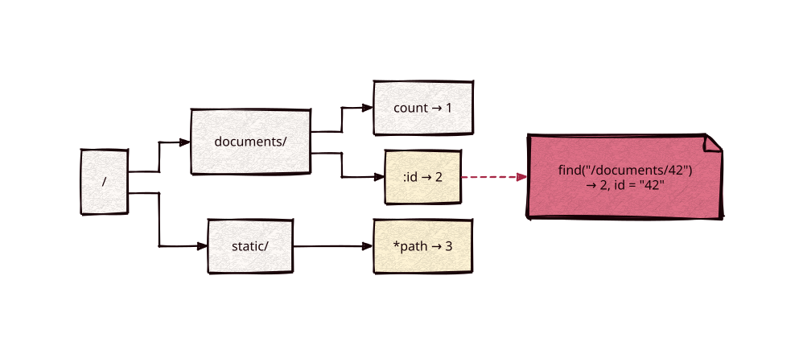

# radix-router

Part of [Kronuz C++ Libraries](https://github.com/Kronuz/cpp-libraries), a collection of small, reusable C++ libraries.

[](https://github.com/Kronuz/radix-router/actions/workflows/ci.yml)
[](LICENSE)


A path router for C++20: map `/`-separated patterns to values of any type, and look
paths up in time that doesn't grow with the number of routes. About 25 ns per lookup
at 1,024 routes, where a linear scan takes 5 µs.



## ✨ Highlights

- ⚡ **Flat lookups**: a compressed prefix trie, as in httprouter, Gin, and Echo; cost
  follows the path length, not the route count.
- 🧩 **Patterns**: static segments, `:name` for one segment, `*name` for the rest.
- 🪶 **Zero-copy**: parameter names and values are `std::string_view`s; lookups
  allocate nothing once `Params` has grown.
- 🚦 **Conflicts fail early**: ambiguous patterns throw from `insert()` at setup.
- 🔌 **Transport-agnostic**: maps strings to values; the HTTP binding lives in
  [http](https://github.com/Kronuz/http).

## 📦 Installation

Requires a C++20 compiler; CMake 3.14 or newer for the CMake route. CI builds it on
Linux (x86_64, arm64), macOS (arm64, x86_64), and FreeBSD, plus ASan, UBSan, and TSan
builds.

```cmake
include(FetchContent)
FetchContent_Declare(radix_router
  GIT_REPOSITORY https://github.com/Kronuz/radix-router.git
  GIT_TAG        main)
FetchContent_MakeAvailable(radix_router)

target_link_libraries(my_app PRIVATE radix_router::radix_router)
```

Or copy `radix_router.h` onto your include path.

## 🚀 Quick start

```cpp
#include "radix_router.h"

#include <cassert>

int main() {
	radix::Router<int> r;
	r.insert("/documents/count", 1);
	r.insert("/documents/:id", 2);     // one segment
	r.insert("/static/*path", 3);      // the rest of the path

	radix::Params params;
	const int* v = r.find("/documents/42", params);
	assert(v && *v == 2);
	assert(params.get("id") == "42");  // a view into the path
}
```

## 🎯 When to use it

- ✅ Dispatching URL paths, RPC method names, or any `/`-separated keys.
- ❌ Regex or per-segment constraints (`:id{[0-9]+}`): match the shape here, then
  validate in the handler.
- ⚠️ Static and wildcard children can't share a position: `/users/new` and
  `/users/:id` conflict, as in httprouter.

## 📚 Documentation

- [ARCHITECTURE.md](ARCHITECTURE.md): why a radix tree, the pattern rules, and the
  zero-copy design.
- [docs/BENCHMARKS.md](docs/BENCHMARKS.md): radix tree against a linear scan.
- [AGENTS.md](AGENTS.md): repository map and invariants.

## 🛠️ Building and testing

```sh
cmake -B build -DCMAKE_BUILD_TYPE=Release && cmake --build build
ctest --test-dir build
./build/radix_router_bench
```

## 🤝 Contributing

Issues and pull requests are welcome. Read [AGENTS.md](AGENTS.md) first. CI must
pass on every platform.

## 📄 License

MIT, Copyright (c) 2026 Germán Méndez Bravo. See [LICENSE](LICENSE).
