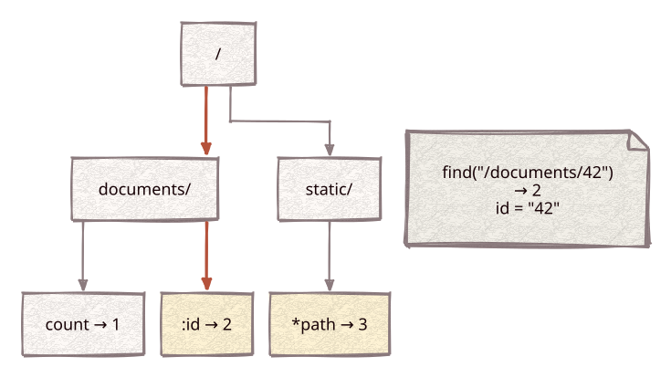

# radix-router

Part of [Kronuz C++ Libraries](https://github.com/Kronuz/cpp-libraries), a collection of small, reusable C++ libraries.

[](https://github.com/Kronuz/radix-router/actions/workflows/ci.yml)
[](LICENSE)


Header-only radix-tree path router for C++20: static, :param and *catch-all segments, captures as string views.
Routes that share a prefix share a branch of one tree, so a lookup walks the
path once instead of testing routes one by one, the structure httprouter, Gin and
Echo use. A static child is tried before a parameter and a parameter before a
catch-all, so `/users/new` and `/users/:id` can both be registered. Reach for it
to dispatch URL paths, RPC names or any `/`-separated keys to values of any type.



## ✨ Highlights

- **One walk per lookup.** Shared prefixes are compressed into single edges; a
  path without wildcards on its way descends with no backtracking.
- **Patterns.** Static segments, `:name` for one segment, `*name` for the rest of
  the path, or, before more segments (`/files/*path/raw`), for the run of
  segments that lets the rest match.
- **Overlapping routes.** Static beats parameter beats catch-all at every node;
  backtracking, where a node needs it, is bounded by the number of segments.
- **Zero-copy captures.** Parameter names and values are `std::string_view`s into
  the pattern and the path; a lookup allocates nothing once `Params` has grown.
- **Mistakes fail at setup.** A duplicate pattern, two names for one parameter
  position, or an unnamed wildcard throws from `insert()`.
- **Transport-agnostic.** It maps strings to values; the HTTP binding lives in
  [http](https://github.com/Kronuz/http).
- **One header, no dependencies.**

## 🚀 Quick start

```cpp
#include "radix_router.h"

#include <cstdio>

int main() {
	radix::Router<int> r;
	r.insert("/documents/count", 1);
	r.insert("/documents/:id", 2);                       // one segment
	r.insert("/static/*path", 3);                        // the rest of the path

	radix::Params params;                                // reuse it across lookups
	const int* v = r.find("/documents/42", params);
	std::string_view id = params.get("id");              // a view into the path
	std::printf("%d %.*s\n", *v, int(id.size()), id.data());   // 2 42

	v = r.find("/documents/count", params);              // static beats :id
	std::printf("%d\n", *v);                             // 1

	v = r.find("/static/css/site.css", params);
	std::string_view path = params.get("path");
	std::printf("%d %.*s\n", *v, int(path.size()), path.data());   // 3 css/site.css

	std::printf("%d\n", r.find("/users", params) == nullptr);      // 1: no route
}
```

## 📦 Installation

Requires a C++20 compiler and CMake 3.14 or newer; no dependencies. CI builds it
on Linux (x86_64, arm64), macOS (arm64, x86_64), and FreeBSD, plus ASan, UBSan,
and TSan builds.

```cmake
include(FetchContent)
FetchContent_Declare(radix_router
  GIT_REPOSITORY https://github.com/Kronuz/radix-router.git
  GIT_TAG        90f38133dd7d93b90924e11050e4101a7232fdc6)  # or main for the tip
FetchContent_MakeAvailable(radix_router)

target_link_libraries(my_app PRIVATE radix_router::radix_router)
```

```cpp
#include "radix_router.h"
```

Without CMake, copy `radix_router.h` onto your include path.

## 🎯 When to use it

Use it to route paths with named parameters, where the table is built once and
read many times.

Not for:

- **Constraints on a segment.** There is no regex or `:id{[0-9]+}`: match the
  shape here, then validate the value in the handler.
- **Two wildcards in one segment.** `/:a-:b` throws; a segment holds one
  wildcard, and it must be named.
- **Captures that outlive the path.** Parameter values are views into the string
  passed to `find()`.
- **The fastest lookup in a large table.** At 1,024 routes a segment trie on a
  hash map is 1.7x to 1.9x faster (see below).

## ⚡ Performance

`bench/compare.cc` times `radix::Router` against a segment trie, one hash-map
level per path segment (`absl::flat_hash_map`), on REST-shaped route tables where
both return the same value and parameters, checked before each row is timed.
Time per lookup, `-O3`, Apple clang 17, abseil 20260817.0:

| workload | Apple M4 Pro: radix / segment trie | Intel Core i9-9980HK: radix / segment trie |
|---|---:|---:|
| 16 routes, static hit | 21.8 ns / 28.3 ns | 39.6 ns / 57.5 ns |
| 16 routes, param hit | 38.5 ns / 32.4 ns | 72.0 ns / 57.2 ns |
| 128 routes, miss | 11.9 ns / 21.1 ns | 25.3 ns / 36.7 ns |
| 1,024 routes, static hit | 42.0 ns / 25.0 ns | 87.2 ns / 47.9 ns |
| 1,024 routes, param hit | 61.5 ns / 34.6 ns | 122.8 ns / 63.3 ns |
| 1,024 routes, miss | 12.2 ns / 21.4 ns | 25.1 ns / 36.4 ns |

```sh
cmake -B build -DCMAKE_BUILD_TYPE=Release -DRADIX_ROUTER_BUILD_BENCH=ON
cmake --build build --target radix_router_compare
./build/radix_router_compare
```

The radix tree answers a miss 1.3x to 1.8x faster than the segment trie and wins
static hits in small tables; the segment trie wins parameter hits at every size.
[docs/BENCHMARKS.md](docs/BENCHMARKS.md) has every row, a hash map of whole
paths, and the linear scan of `./build/radix_router_bench`.

## 📚 Documentation

- [ARCHITECTURE.md](ARCHITECTURE.md): why a radix tree, the pattern rules and
  their priority, and the zero-copy design.
- [docs/BENCHMARKS.md](docs/BENCHMARKS.md): the radix tree against a linear scan,
  a hash map of exact routes and a segment trie.
- [AGENTS.md](AGENTS.md): repository map and invariants.
- [Kronuz C++ Libraries](https://github.com/Kronuz/cpp-libraries/blob/main/AGENTS.md#radix-router): the catalog entry.

## 🛠️ Building and testing

```sh
cmake -B build
cmake --build build
ctest --test-dir build
```

`./build/radix_router_bench` runs the linear-scan comparison. Add
`-DRADIX_ROUTER_BUILD_BENCH=ON` to build `radix_router_compare`; `ctest` then runs
its `--check` mode, and without abseil the trie uses `std::unordered_map`.

## 🤝 Contributing

Issues and pull requests are welcome. Read [AGENTS.md](AGENTS.md) and the
catalog's [rules of engagement](https://github.com/Kronuz/cpp-libraries/blob/main/AGENTS.md#rules-of-engagement)
first; CI must pass on every platform.

## 📄 License

MIT, Copyright (c) 2026 Germán Méndez Bravo. See [LICENSE](LICENSE).
